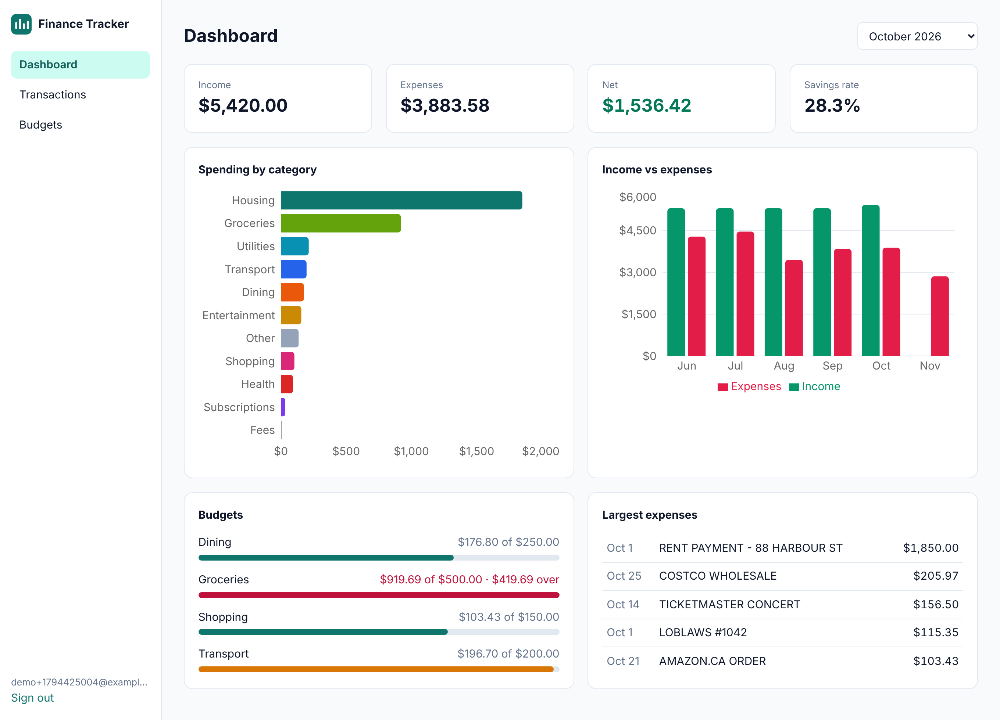
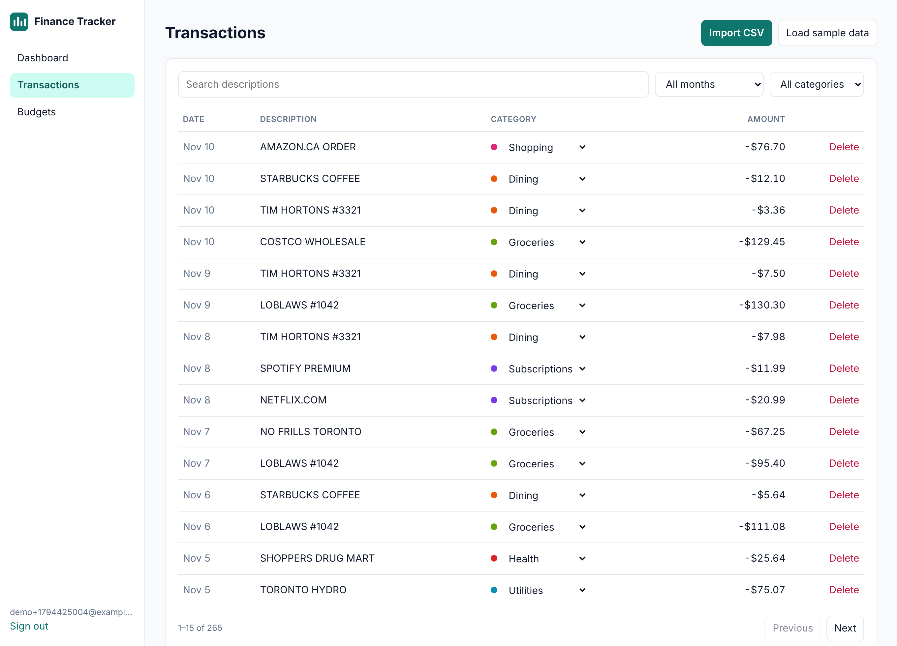
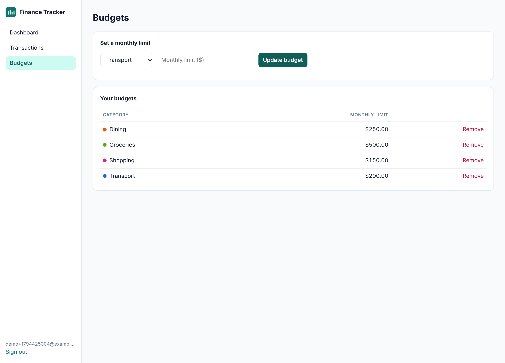
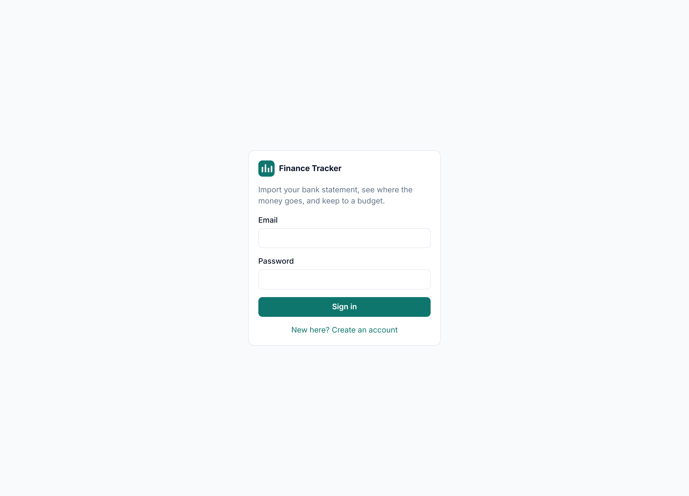
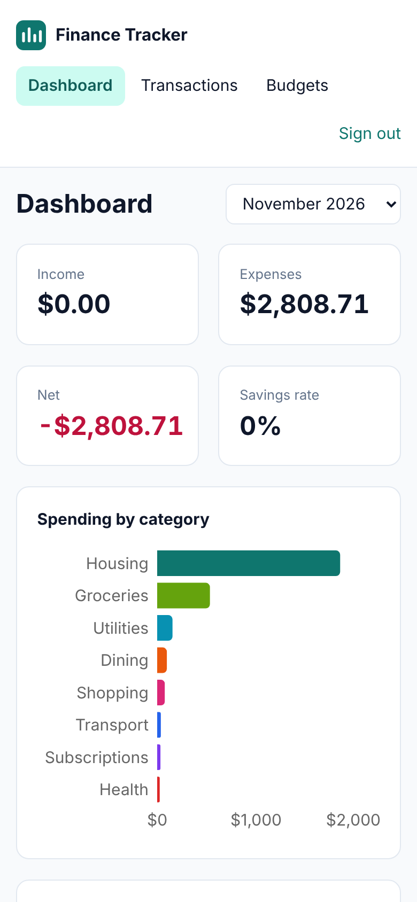

# Finance Tracker

[](https://github.com/keval718/finance-tracker/actions/workflows/ci.yml)

A personal finance app: import a CSV export from your bank, have every transaction
categorized automatically, and see where the money goes each month against the budgets you set.

**Python (FastAPI) backend · React (TypeScript) frontend · SQLite database**



## Features

- **CSV import that copes with real bank exports.** Accepts a signed `Amount` column or separate
  `Debit` / `Credit` columns, several header spellings, mixed date formats, and values like
  `$1,234.50` or `(45.00)`. Bad rows are skipped and counted, not fatal.
- **Safe to re-import.** Each row gets a content fingerprint, so uploading an overlapping statement
  only adds the new transactions. Two identical purchases on the same day are still kept as two.
- **Automatic categorization** with whole-word keyword rules (so `UBER EATS` is Dining and
  `UBER TRIP` is Transport). Any category can be corrected inline.
- **Monthly dashboard:** income, expenses, net, savings rate, spending by category, a six-month
  income-vs-expenses trend, and the largest expenses. Refunds net against the original category.
- **Budgets** per category with progress bars that turn amber near the limit and red over it.
- **Accounts** with bcrypt-hashed passwords and JWT auth. Every query is scoped to the signed-in user.
- Search, filter by month and category, and pagination on the transactions table.

## Screenshots

| Transactions | Budgets |
|---|---|
|  |  |

| Sign in | Mobile |
|---|---|
|  |  |

## Tech stack

| Layer | Tools |
|---|---|
| Backend | Python 3.11+, FastAPI, SQLAlchemy 2, Pydantic 2, pandas, PyJWT, bcrypt |
| Frontend | React 19, TypeScript, Vite, React Router, Recharts |
| Database | SQLite by default; any SQLAlchemy URL works via `DATABASE_URL` |
| Quality | pytest (33 tests), Ruff, Playwright end-to-end script, GitHub Actions CI |

## Run it locally

You need Python 3.11+ and Node 20+.

**1. Backend** (http://localhost:8000, interactive API docs at `/docs`)

```bash
cd backend
python -m venv .venv
source .venv/bin/activate        # Windows: .venv\Scripts\activate
pip install -r requirements-dev.txt
uvicorn app.main:app --reload
```

The SQLite database file is created on first start. No setup needed.

**2. Frontend** (http://localhost:5173)

```bash
cd frontend
npm install
npm run dev
```

Open http://localhost:5173, create an account, and click **Load sample data** to import six months
of generated transactions (or import [`sample_data/sample_transactions.csv`](sample_data/sample_transactions.csv)
or your own bank export).

### Or with Docker

```bash
docker compose up --build
```

Then open http://localhost:8080.

## Tests

```bash
cd backend
pytest              # API, importer and categorizer tests against an in-memory database
ruff check .        # lint
```

End-to-end check in a real browser (also regenerates the screenshots above). With both servers
running:

```bash
pip install playwright && playwright install chromium
python scripts/e2e_screenshots.py
```

## Project structure

```
backend/
  app/
    main.py            FastAPI app and router wiring
    config.py          Settings from environment variables
    database.py        SQLAlchemy engine and session dependency
    models.py          User, Transaction, Budget tables
    schemas.py         Pydantic request and response models
    security.py        Password hashing, JWT, current-user dependency
    importer.py        CSV parsing and normalization (pandas)
    categorizer.py     Keyword rules for categories
    routers/           auth, transactions, budgets, analytics endpoints
  tests/               pytest suite
frontend/
  src/
    api.ts             Typed API client
    AuthProvider.tsx   Session state
    pages/             Login, Dashboard, Transactions, Budgets
    components/        Layout, ImportButtons
scripts/               Sample data generator, end-to-end script
sample_data/           Example bank export
```

## API overview

All routes except register, login and health need an `Authorization: Bearer <token>` header.

| Method | Path | Purpose |
|---|---|---|
| POST | `/api/auth/register` | Create an account |
| POST | `/api/auth/login` | Get an access token |
| GET | `/api/auth/me` | Current user |
| GET | `/api/transactions` | List with `month`, `category`, `search`, `page`, `page_size` |
| POST | `/api/transactions` | Add one transaction |
| POST | `/api/transactions/import` | Upload a CSV file |
| PATCH | `/api/transactions/{id}` | Change category |
| DELETE | `/api/transactions/{id}` | Delete |
| GET | `/api/transactions/categories` | Category names |
| GET / PUT | `/api/budgets` | List budgets / create or update one |
| DELETE | `/api/budgets/{id}` | Remove a budget |
| GET | `/api/analytics/summary?month=YYYY-MM` | Totals, categories, budget status, top expenses |
| GET | `/api/analytics/trend?months=6` | Income and expenses per month |
| GET | `/api/analytics/months` | Months that have data |

## Configuration

Copy `backend/.env.example` to `backend/.env`. Set `SECRET_KEY` to a long random value before
deploying; the built-in default is for local development only.

## Possible next steps

- Alembic migrations in place of `create_all`
- User-defined categorization rules
- Recurring-payment detection and month-over-month comparisons
